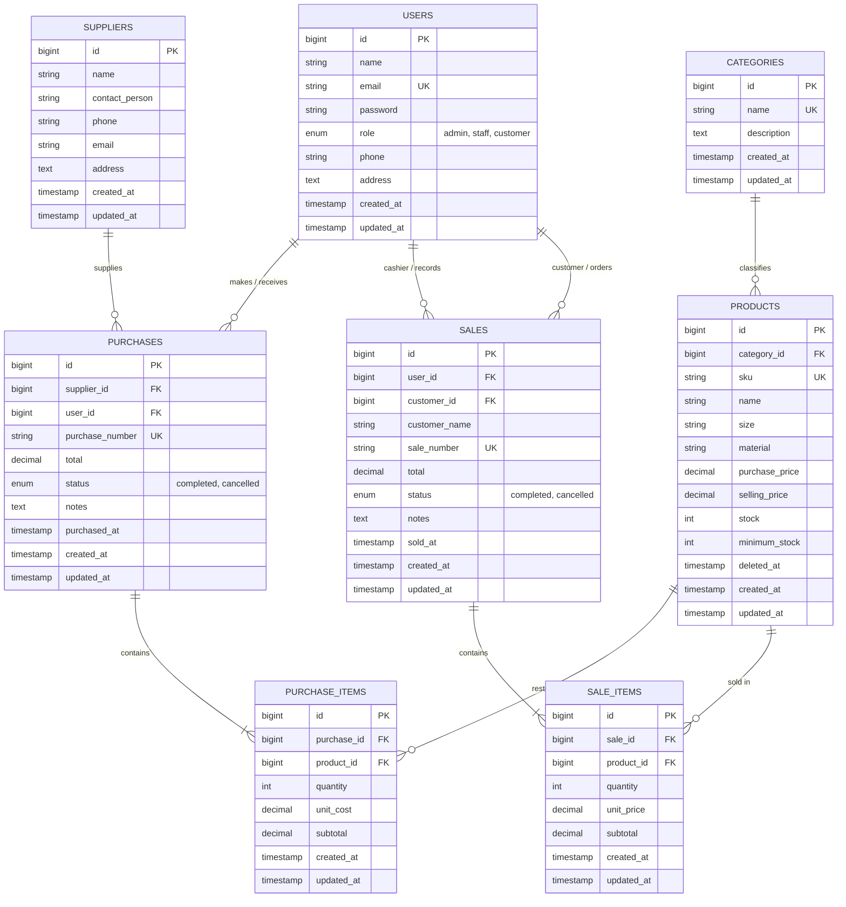

# Diza's Plushie - Integrated Inventory & Sales Management System

[](https://laravel.com)
[](https://php.net)
[](https://mysql.com)
[](https://tailwindcss.com)
[-success?style=for-the-badge&logo=checkmarx&logoColor=white)](#panduan-pengujian-otomatis-automated-testing-guide)

Aplikasi Web Terintegrasi untuk **Sistem Manajemen Inventori & Transaksi Penjualan Toko Boneka "Diza's Plushie" (Cute & Aesthetic Doll & Plushie Store)**, dibangun dengan tema **Soft Pastel Aesthetic yang manis, modern, dan lembut** sebagai pemenuhan **Tugas Ujian Tengah Semester (UTS) Mata Kuliah Web Programming 2**.

---

## Daftar Isi
1. [Project Overview & Skenario Bisnis](#1-project-overview--skenario-bisnis)
2. [Spesifikasi & System Requirements](#2-spesifikasi--system-requirements)
3. [Panduan Instalasi & Setup Lingkungan (Reproducible)](#3-panduan-instalasi--setup-lingkungan-reproducible)
4. [Entity Relationship Diagram (ERD) & Penjelasan Relasi Database](#4-entity-relationship-diagram-erd--penjelasan-relasi-database)
5. [Matriks Hak Akses & Peran Pengguna (Role-Based Access Control)](#5-matriks-hak-akses--peran-pengguna-role-based-access-control)
6. [Daftar Akun Demo Pengujian & Sistem Login 3 Role](#6-daftar-akun-demo-pengujian--sistem-login-3-role)
7. [Fitur Unggulan & Aturan Bisnis yang Diimplementasikan](#7-fitur-unggulan--aturan-bisnis-yang-diimplementasikan)
8. [Panduan Pengujian Otomatis (Automated Testing Guide)](#8-panduan-pengujian-otomatis-automated-testing-guide)
9. [Known Limitations & Pengembangan Selanjutnya](#9-known-limitations--pengembangan-selanjutnya)

---

## 1. Project Overview & Skenario Bisnis

**Diza's Plushie** adalah sistem informasi manajemen inventori dan kasir modern yang dirancang khusus untuk toko ritel boneka dan plushie impor dengan visualisasi **Soft Pastel Aesthetic** (warna Creamy White `#FFF9FB`, Soft Blush `#FDF2F8`, Pastel Pink `#FBCFE8`, Soft Mint `#D1FAE5`, Baby Peach `#FFEDD5`, dan font manis Quicksand & Plus Jakarta Sans).

Sistem ini mengintegrasikan rantai pasok pengadaan boneka dari pabrik/pemasok (*Stock-In*) hingga penjualan ritel ke konsumen (*Stock-Out*), baik melalui kasir toko fisik maupun pemesanan mandiri oleh pelanggan terdaftar (*Customer Self-Service Order*).

### Masalah Bisnis yang Diselesaikan:
- **Ketidakkonsistenan Stok**: Mengatasi risiko *overselling* atau selisih stok fisik akibat transaksi penjualan bersamaan dengan mengimplementasikan mekanisme konkurensi `Product::lockForUpdate()` di dalam transaksi atomik database (`DB::transaction`).
- **Pencegahan Data Korup (Multi-Item Atomicity)**: Jika pelanggan membeli beberapa jenis boneka sekaligus dan stok salah satu boneka habis di tengah proses simpan, sistem secara otomatis membatalkan seluruh transaksi (*atomic rollback*), memastikan tidak ada stok yang terpotong sebagian atau nota yang tersimpan tanpa barang lengkap.
- **Transparansi Biaya & Keamanan Peran**: Memisahkan secara ketat informasi harga modal (*purchase price*) dari pandangan pelanggan, sekaligus memberikan visibilitas penuh bagi pemilik toko (*Admin*) dan kasir/gudang (*Staff*).
- **Monitoring Dini Kehabisan Stok**: Menyediakan dasbor pemantauan otomatis untuk produk yang sisa stoknya berada di bawah batas minimum (*low stock alert*).
- **Pengalaman Pelanggan Bebas Hambatan (Passwordless Customer Login)**: Pelanggan tidak perlu mengingat atau memasukkan password saat login. Cukup memasukkan Nama dan Email, sistem langsung mengenali atau mendaftarkan akun baru secara otomatis.
- **Dukungan Beragam Metode Pembayaran**: Transaksi kasir dan online mendukung metode bayar modern (QRIS Instant QR, Transfer Bank BCA/Mandiri/BSI, E-Wallet GoPay/OVO/ShopeePay/DANA, dan Tunai/COD).
- **Ilustrasi Boneka Offline 100% Selalu Tampil**: Menyediakan 10 ilustrasi boneka SVG lokal yang aesthetic di folder `public/images/plushies/` sehingga katalog dan struk selalu tampil cantik tanpa bergantung pada koneksi internet luar.

---

## 2. Spesifikasi & System Requirements

Aplikasi ini dibangun menggunakan arsitektur modern Laravel 12 dengan dependensi berikut:
- **PHP**: Versi `^8.2` (dengan ekstensi `pdo_mysql`, `mbstring`, `openssl`, `tokenizer`, `xml`, `ctype`, `json`, `bcmath`).
- **Database Server**: MySQL `8.x` / MariaDB (bawaan XAMPP default port `3306`).
- **Dependency Manager**: Composer `2.x`.
- **Web Browser**: Google Chrome, Mozilla Firefox, Microsoft Edge, atau Safari versi terkini.
- **Framework**: Laravel `12.x`.
- **Frontend Assets**: Tailwind CSS, Font Awesome 6 Icons, Google Fonts (Quicksand & Plus Jakarta Sans).

---

## 3. Panduan Instalasi & Setup Lingkungan (Reproducible)

Ikuti langkah-langkah di bawah ini untuk mengkloning dan menjalankan project dari nol di komputer lokal / XAMPP:

### Langkah 1: Kloning Repositori Git
Buka terminal (Git Bash, Command Prompt, atau PowerShell) di direktori kerja Anda (misal `c:/xampp/htdocs`):
```bash
git clone https://github.com/zahrapradiza/Integrated-Laravel-Project.git
cd Integrated-Laravel-Project
```

### Langkah 2: Instalasi Dependensi PHP via Composer
Jalankan perintah berikut untuk mengunduh seluruh vendor package:
```bash
composer install
```

### Langkah 3: Konfigurasi File Environment (`.env`)
Salin file template `.env.example` menjadi `.env`:
```bash
cp .env.example .env
```
*(Di Windows PowerShell gunakan: `copy .env.example .env`)*

Buka file `.env` dan pastikan konfigurasi koneksi MySQL sesuai dengan konfigurasi XAMPP lokal:
```env
APP_NAME="Diza's Plushie"
APP_ENV=local
APP_KEY=
APP_DEBUG=true
APP_TIMEZONE=Asia/Jakarta
APP_URL=http://127.0.0.1:8000

DB_CONNECTION=mysql
DB_HOST=127.0.0.1
DB_PORT=3306
DB_DATABASE=db_uts_boneka
DB_USERNAME=root
DB_PASSWORD=

SESSION_DRIVER=file
SESSION_DOMAIN=
SESSION_SECURE_COOKIE=false
CACHE_STORE=file
```

### Langkah 4: Generate Application Encryption Key
Buat kunci aplikasi unik Laravel:
```bash
php artisan key:generate
```

### Langkah 5: Pembuatan Database & Eksekusi Migration + Seeder
Pastikan service MySQL di XAMPP Control Panel telah aktif (**Status: Running**).
Buat database baru bernama `db_uts_boneka` via phpMyAdmin atau terminal MySQL:
```sql
CREATE DATABASE db_uts_boneka CHARACTER SET utf8mb4 COLLATE utf8mb4_unicode_ci;
```

Jalankan migrasi tabel beserta seeder data demo realistis tema toko boneka:
```bash
php artisan migrate --seed
```

Perintah di atas akan secara otomatis mengeksekusi migrasi 8 tabel serta mengisi akun demo (Admin, Staff, Customer), 5 kategori boneka, 4 pabrik supplier, 10 data boneka, 2 transaksi pembelian awal, dan 3 transaksi penjualan awal.

### Langkah 6: Jalankan Server Development
Jalankan server bawaan Laravel:
```bash
php artisan serve
```
Aplikasi kini siap diakses melalui web browser pada URL: **`http://127.0.0.1:8000`**

---

## 4. Entity Relationship Diagram (ERD) & Penjelasan Relasi Database

### Diagram ERD (Mermaid)
Berikut adalah visualisasi skema database relasional aplikasi BonekaKu:



### Penjelasan Konsep Relasi Eloquent

#### 1. Perbedaan Fundamental Antara `hasMany()` dan `belongsTo()`
- **`hasMany()` (Sisi Parent / 1-to-N)**:
  - Menyatakan bahwa satu entitas induk memiliki keterkaitan dengan banyak entitas anak.
  - Model induk **tidak menyimpan** kolom foreign key anak.
  - *Contoh di kode*: Pada model `Category`, didefinisikan relasi `public function products(): HasMany { return $this->hasMany(Product::class); }`. Satu kategori boneka (misal: *Teddy Bear Classic*) menaungi banyak produk boneka. Hal serupa berlaku pada `Sale::hasMany(SaleItem::class)`.
- **`belongsTo()` (Sisi Child / N-to-1)**:
  - Menyatakan bahwa entitas tersebut merujuk pada satu induk tertentu.
  - Model anak adalah tempat di mana kolom foreign key fisik (`category_id`, `product_id`, `sale_id`) disimpan di tabel database.
  - *Contoh di kode*: Pada model `Product`, didefinisikan `public function category(): BelongsTo { return $this->belongsTo(Category::class); }`. Setiap boneka terikat tepat pada satu kategori induk.

#### 2. Alasan Mengapa Foreign Key Berada pada Tabel Detail (`purchase_items` & `sale_items`)
Penempatan foreign key pada tabel detail merupakan implementasi prinsip **Normalisasi Database (1NF, 2NF, dan 3NF)**:
1. **Dukungan Transaksi Multi-Item (Kardinalitas 1 ke Banyak)**:
   Satu nota transaksi penjualan (`sales`) atau pesanan pembelian (`purchases`) dapat memuat $N$ ragam produk boneka yang berbeda dengan kuantitas dan harga satuan masing-masing.
2. **Menghindari Perulangan Kolom (Atomicity & Eliminasi Redundansi)**:
   Jika foreign key diletakkan di tabel header `sales`, maka kita akan dipaksa membuat kolom kaku berulang seperti `product_id_1`, `product_id_2`, ..., `product_id_n` yang melanggar Normalisasi Bentuk Pertama (1NF) dan membatasi fleksibilitas transaksi.
3. **Pencatatan Historis Akurat**:
   Tabel detail menyimpan snapshot harga historis (`unit_price` dan `unit_cost`) pada saat transaksi berlangsung. Dengan demikian, jika di masa depan harga master produk boneka berubah, seluruh laporan keuangan dan nilai nota transaksi masa lalu tetap valid dan tidak mengalami pergeseran nilai.

---

## 5. Matriks Hak Akses & Peran Pengguna (Role-Based Access Control)

Aplikasi menerapkan sistem otorisasi berlapis menggunakan middleware server-side kustom (`RoleMiddleware`):

| Fitur / Modul Sistem | Route Endpoint | Admin (Owner) | Staff (Kasir/Gudang) | Customer (Pembeli) |
| :--- | :--- | :---: | :---: | :---: |
| **Login, Logout, & Register** | `/login`, `/logout`, `/register` | ✅ Akses | ✅ Akses | ✅ Akses (Bisa Daftar Baru) |
| **Dashboard Utama** | `GET /dashboard` | ✅ Full Metrik Omzet & Low-Stock | ✅ Metrik Operasional & Low-Stock | ✅ Ringkasan Belanja Mandiri |
| **Kategori Boneka (Lihat)** | `GET /categories` | ✅ Akses | ✅ Akses | ❌ 403 Forbidden |
| **Kategori Boneka (Tambah/Ubah/Hapus)** | `POST/PUT/DELETE /categories` | ✅ Hak Penuh | ❌ 403 Forbidden | ❌ 403 Forbidden |
| **Pemasok Supplier (Lihat)** | `GET /suppliers` | ✅ Akses | ✅ Akses | ❌ 403 Forbidden |
| **Pemasok Supplier (Mutasi)** | `POST/PUT/DELETE /suppliers` | ✅ Hak Penuh | ❌ 403 Forbidden | ❌ 403 Forbidden |
| **Master Produk Boneka (Lihat/Katalog)** | `GET /products`, `/catalog` | ✅ Tabel Master | ✅ Tabel Master | ✅ Katalog Belanja (Tanpa Harga Modal) |
| **Master Produk (Tambah/Ubah/Hapus)** | `POST/PUT/DELETE /products` | ✅ Hak Penuh (Soft Delete) | ❌ 403 Forbidden | ❌ 403 Forbidden |
| **Pengadaan Pembelian (Stock-In)** | `GET/POST /purchases`, `/create` | ✅ Akses | ✅ Akses | ❌ 403 Forbidden |
| **Batalkan Transaksi Pembelian** | `POST /purchases/{id}/cancel` | ✅ Hak Penuh | ❌ 403 Forbidden | ❌ 403 Forbidden |
| **Daftar Seluruh Penjualan Toko** | `GET /sales` | ✅ Semua Transaksi | ✅ Semua Transaksi | 🔒 Hanya Transaksi Miliknya Sendiri |
| **Buat Transaksi Penjualan (Kasir/Self)** | `GET/POST /sales`, `/create` | ✅ Kasir POS (Pilih Member/Guest) | ✅ Kasir POS (Pilih Member/Guest) | ✅ Order Mandiri (Otomatis Akun Sendiri) |
| **Detail Faktur / Nota Penjualan** | `GET /sales/{sale}` | ✅ Akses Seluruh Nota | ✅ Akses Seluruh Nota | 🔒 Nota Sendiri (Nota Orang Lain: 403) |
| **Batalkan Transaksi Penjualan** | `POST /sales/{sale}/cancel` | ✅ Hak Penuh (Stok Dikembalikan) | ❌ 403 Forbidden | ❌ 403 Forbidden |
| **Manajemen Pengguna & Hak Akses** | `GET/POST/PUT/DELETE /users` | ✅ CRUD Pengguna & Ubah Role | ❌ 403 Forbidden | ❌ 403 Forbidden |

---

## 6. Daftar Akun Demo Pengujian & Sistem Login 3 Role

Aplikasi menyediakan **Sistem Portal Login 3 Role** di route `/login`:
- **Portal Customer (Masuk Cepat Tanpa Password)**: Cukup memasukkan `Nama Lengkap` dan `Email`. Jika email telah terdaftar sebagai customer, sistem langsung melakukan login otomatis. Jika belum terdaftar, akun customer baru otomatis dibuatkan di belakang layar!
- **Portal Staff**: Memerlukan `Email` dan `Password` dengan validasi server-side khusus role `staff`.
- **Portal Administrator**: Memerlukan `Email` dan `Password` dengan validasi server-side khusus role `admin`.
- **Keamanan Halaman Login**: Seluruh bocoran password/daftar akun demo telah dihilangkan dari tampilan layar `/login` agar aman dan rapi.

Untuk keperluan pengujian dosen / demo, akun bawaan database seeder adalah:

| Role | Nama Pengguna | Alamat Email | Password | Kegunaan / Skenario Pengujian |
| :--- | :--- | :--- | :--- | :--- |
| **Admin** | `Admin Owner Diza's Plushie` | `admin@bonekaku.test` | `password123` | Hak akses penuh: Master data, kelola user & role, pembatalan transaksi, dashboard omzet. |
| **Staff** | `Siti Kasir & Gudang` | `staff@bonekaku.test` | `password123` | Operasional: Input pengadaan Stock-In, input kasir penjualan multi-item, monitor stok rendah. |
| **Staff** | `Budi Staff Inventori` | `budi.staff@bonekaku.test` | `password123` | Pengujian akses bersama antar staff operasional toko. |
| **Customer**| `Nadia Putri (Customer)` | `customer@bonekaku.test` | *Tanpa Password* (atau `password123`) | Pemesanan boneka mandiri, melihat riwayat pesanan pribadi, faktur nota belanja. |
| **Customer**| `Rizky Pratama (Customer)`| `rizky@bonekaku.test` | *Tanpa Password* (atau `password123`) | Pengujian isolasi data: Memverifikasi Customer A tidak bisa membuka nota Customer B. |

> **Catatan Pengujian Customer**: Pada tab Customer di `/login`, penguji cukup memasukkan email `customer@bonekaku.test` (atau email sembarang untuk registrasi instan otomatis) tanpa perlu mengetikkan password sama sekali.

---

## 7. Fitur Unggulan & Aturan Bisnis yang Diimplementasikan

### 1. Kepatuhan Presisi terhadap Spesifikasi Dosen (Slide 16)
Penyimpanan transaksi penjualan pada `SaleController@store` mengimplementasikan pola transaksi terdistribusi yang direkomendasikan pada slide kuliah:
```php
DB::transaction(function () use ($request, $customerId, $customerName) {
    // 1. Buat Header Sale (total diinisialisasi 0)
    $sale = Sale::create([...]);
    $total = 0;

    // 2. Looping Item dengan Concurrency Locking
    foreach ($request->items as $item) {
        $product = Product::lockForUpdate()->findOrFail($item['product_id']);
        $qty = (int) $item['quantity'];

        // Validasi Ketersediaan Stok Fisik
        if ($qty < 1 || $product->stock < $qty) {
            throw ValidationException::withMessages([
                'items' => "Stok boneka '{$product->name}' tidak mencukupi (Stok tersedia: {$product->stock}, diminta: {$qty}). Transaksi dibatalkan secara otomatis.",
            ]);
        }

        $subtotal = $product->selling_price * $qty;
        $sale->items()->create([...]);

        // Pengurangan Stok Atomik & Akumulasi Nilai
        $product->decrement('stock', $qty);
        $total += $subtotal;
    }

    // 3. Update Nilai Total Header Resmi dari Database
    $sale->update(['total' => $total]);
    return $sale;
});
```

### 2. Penjaminan Integritas Atomik (All-or-Nothing Rollback)
Jika pelanggan memesan boneka A (stok cukup) dan boneka B (stok kurang) dalam satu keranjang belanja, `ValidationException` akan memicu pembatalan total pada `DB::transaction`. Akibatnya:
- Boneka A **sama sekali tidak berkurang** stoknya.
- Header transaksi `Sale` dan item `SaleItem` **tidak tersimpan** di database.

### 3. Otomasi Stock-In & Stock-Out Dua Arah
- **Stock-In (`PurchaseController`)**: Transaksi pengadaan dari pabrik otomatis menambahkan stok boneka (`$product->increment('stock', $qty)`). Jika transaksi dibatalkan oleh Admin, sistem memverifikasi bahwa sisa stok saat ini masih mencukupi sebelum memotong kembali stok agar tidak bernilai negatif.
- **Stock-Out (`SaleController`)**: Penjualan otomatis memotong stok fisik. Jika transaksi dibatalkan oleh Admin, sistem mengunci produk dan mengembalikan seluruh kuantitas ke inventori toko (`$product->increment('stock', $qty)`).

### 4. Perlindungan Data Relasional dengan Soft Deletes
Model `Product` mengimplementasikan trait `SoftDeletes` (`deleted_at`). Jika produk dinonaktifkan atau dihapus oleh Admin:
- Produk tidak lagi muncul di pilihan transaksi baru.
- Laporan transaksi penjualan dan pembelian masa lalu yang memuat produk tersebut **tetap utuh dan dapat dibuka tanpa error** (*relational integrity preserved*).
- Penghapusan Kategori dan Supplier diproteksi secara relasional; Kategori tidak dapat dihapus jika masih menaungi produk boneka aktif.

### 5. Keamanan Perhitungan Server-Side 100%
Kalkulasi subtotal dan grand total dihitung 100% di server berdasarkan nilai `selling_price` resmi di database. Manipulasi harga pada request browser / payload HTTP tidak akan mempengaruhi nominal asli transaksi.

---

## 8. Panduan Pengujian Otomatis (Automated Testing Guide)

Aplikasi dilengkapi dengan suite pengujian otomatis komprehensif menggunakan PHPUnit dan Laravel Test Runner.

### Menjalankan Seluruh Automated Test
Jalankan perintah berikut di terminal:
```bash
php artisan test
```

### Hasil Eksekusi Test:
```
   PASS  Tests\Unit\ExampleTest
  ✓ that true is true

   PASS  Tests\Feature\AuthAndRoleTest (9 tests)
  ✓ login screen can be rendered
  ✓ register screen can be rendered
  ✓ guest is redirected to login
  ✓ admin can access dashboard and admin routes
  ✓ staff cannot access admin only route
  ✓ customer cannot access admin or staff routes
  ✓ customer can access dashboard
  ✓ user can login with valid credentials
  ✓ user cannot login with invalid password

   PASS  Tests\Feature\MasterDataTest (8 tests)
  ✓ staff can view categories and suppliers but not create
  ✓ customer cannot view categories or suppliers or users
  ✓ admin can create category with validation
  ✓ category cannot be deleted if has products
  ✓ supplier cannot be deleted if has purchases
  ✓ admin can create product with validation
  ✓ product soft delete preserves transaction integrity
  ✓ admin cannot delete self in user management

   PASS  Tests\Feature\PurchaseTest (6 tests)
  ✓ staff and admin can access purchases index and create
  ✓ customer cannot access purchases
  ✓ store multi item purchase updates stock atomically
  ✓ staff cannot cancel purchase
  ✓ admin can cancel purchase and stock is deducted
  ✓ admin cannot cancel purchase if stock would become negative

   PASS  Tests\Feature\SaleTest (5 tests)
  ✓ all roles can access sales index and create
  ✓ customer can create self order and stock is decremented
  ✓ insufficient stock causes transaction rollback
  ✓ customer cannot view other customers receipt
  ✓ staff cannot cancel sale but admin can and stock is restored

   PASS  Tests\Feature\DashboardTest (3 tests)
  ✓ admin dashboard displays aggregate metrics and low stock table
  ✓ staff dashboard displays operational metrics and low stock monitoring
  ✓ customer dashboard displays order history and doll recommendations

   PASS  Tests\Feature\UtsInventorySalesTest (7 tests - Slide 11 Compliance)
  ✓ guest cannot access dashboard
  ✓ admin cannot create product with duplicate sku or negative price
  ✓ purchase transaction increases product stock
  ✓ sale transaction decreases product stock
  ✓ sale with insufficient stock is rejected and stock unchanged
  ✓ sale atomicity rolls back all items if second item fails
  ✓ authorization prevents staff and customer from accessing admin routes

  Tests:    40 passed (184 assertions)
  Duration: ~2.2s
```

### Menjalankan Pengujian Spesifik Slide 11 Dosen
Untuk memverifikasi 7 skenario wajib dari dosen secara terisolasi:
```bash
php artisan test --filter=UtsInventorySalesTest
```

---

## 9. Known Limitations & Pengembangan Selanjutnya

Meskipun sistem telah memenuhi seluruh kriteria fungsional dan teknis tugas UTS Web Programming 2, terdapat beberapa peluang pengembangan di masa mendatang:
1. **Payment Gateway Integration**: Menghubungkan pesanan online customer ke payment gateway otomatis (seperti Midtrans atau Xendit) untuk verifikasi pembayaran real-time via QRIS/Virtual Account.
2. **Export Laporan (PDF / Excel)**: Penambahan generator PDF invoice cetak otomatis menggunakan package `barryvdh/laravel-dompdf` atau export spreadsheet `maatwebsite/excel`.
3. **Penyimpanan Gambar Produk**: Menambahkan modul upload foto fisik boneka ke cloud storage (AWS S3) atau disk lokal publik.

---

### Identitas Pengembang
- **Nama Project**: Diza's Plushie Inventory & Sales Management System
- **Repositori GitHub**: [https://github.com/zahrapradiza/Integrated-Laravel-Project](https://github.com/zahrapradiza/Integrated-Laravel-Project)
- **Mata Kuliah**: Web Programming 2 (Ujian Tengah Semester)
- **Tahun Akademik**: 2026
